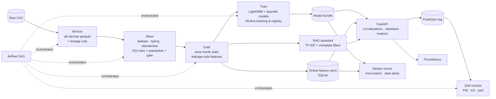

# PropIntel — Property Valuation & Real Estate Market Intelligence Platform

[](.github/workflows/ci.yml)
 

Created and maintained by **Adam Javed** as a portfolio project. This is an end-to-end, production-style **data + ML platform**: a medallion data pipeline, a leakage-safe feature layer
with an online store, a LightGBM valuation model with prediction intervals tracked in **MLflow**, a **FastAPI**
service, a **real-time listing scorer** that raises deal alerts, **drift / performance monitoring**, a grounded
**RAG market-intelligence assistant**, and the delivery tooling around it (Docker, CI, Terraform, Airflow).

> **Data note:** all data is *synthetic*, generated by `propintel.data.generate` to mimic a Dubai residential market
> (10 areas, 48 months, ~60K transactions) **including realistic dirt** (duplicates, nulls, bad dates, outliers,
> casing noise). No real transactions, clients or employer data are used. Metrics below are for this synthetic
> data and show that the system works, not real-world valuation accuracy.

## Architecture



## Project ownership and scope

This repository is a portfolio implementation using synthetic data. Review the design, run the pipeline and tests, and be ready to explain the modelling, data-quality, monitoring, and deployment choices before presenting it professionally. No real estate transactions or employer/client data are included.

## Resume alignment

This project directly supports the resume entry **Property Valuation & Real Estate Market Intelligence Platform** and demonstrates relevant skills in Python, SQL/DuckDB, feature engineering, model training/evaluation, RAG, APIs, MLOps, monitoring, CI, Docker, Terraform, and orchestration. It is a portfolio demonstration—not evidence by itself of production use at any employer. All reported model metrics are calculated on synthetic data and should be described that way.

## What is in the box

| Layer | Implementation | Where |
|---|---|---|
| Ingestion / ETL | DuckDB SQL, Parquet medallion (bronze → silver → gold), lineage columns | `pipeline/medallion.py` |
| Data quality | 7 validation rules, quarantine table with reject reasons, **fail-the-pipeline gate** at 10% rejects, JSON DQ report | `pipeline/medallion.py` |
| Feature pipeline | Lagged / rolling market features computed only from *prior* months (no target leakage, tested); shared `to_matrix` for train = serve | `model/features.py` |
| Online feature store | Materialisation job into SQLite; API enriches requests with latest market state | `pipeline/medallion.py`, `model/predictor.py` |
| Training | LightGBM on log-price, chronological train/valid/test split, early stopping, baseline comparison | `model/train.py` |
| Uncertainty | 10th/90th percentile models → 80% prediction interval, coverage evaluated | `model/train.py` |
| Experiment tracking & registry | MLflow params / metrics / artifacts, model registry, **`champion` alias only if promotion gate passes** | `model/train.py` |
| Serving | FastAPI, pydantic validation, batch endpoint, request-id + latency headers, Prometheus metrics, prediction logging | `serving/app.py` |
| Real-time | Producer/consumer with bounded queue (back-pressure), micro-batching, deal alerts; `EventSource` seam for Kafka / Pub/Sub | `streaming/processor.py` |
| Monitoring | PSI + KS data drift, prediction-ratio drift, live-MAPE performance check, drift API endpoint | `monitoring/drift.py` |
| GenAI / RAG | Quarterly market commentary generated from gold + methodology docs, TF-IDF retrieval with area/period filters, citations, refusal when unsupported, optional LLM synthesis | `rag/assistant.py` |
| CI/CD | GitHub Actions: ruff, pytest matrix, Docker build, Terraform validate | `.github/workflows/ci.yml` |
| IaC | Terraform for GCP: lake bucket, Artifact Registry, least-privilege service account, Cloud Run | `infra/terraform/` |
| Orchestration | Airflow DAG with retries, SLA and a quality gate that blocks downstream tasks | `orchestration/dags/` |
| Containers | Multi-stage non-root Dockerfile, compose stack (MLflow + pipeline job + API + Prometheus) | `Dockerfile`, `docker-compose.yml` |

## Quickstart

```bash
git clone https://github.com/adamjaved-tech/realestate-intelligence-platform.git && cd realestate-intelligence-platform
python -m venv .venv && source .venv/bin/activate
make install
make all          # data -> ETL -> train -> stream replay -> drift demo
make test         # 27 tests
make serve        # http://localhost:8000/docs
```

```bash
curl -s localhost:8000/v1/valuations -H 'content-type: application/json' -d '{
  "area":"Dubai Marina","property_type":"Apartment","bedrooms":2,"bathrooms":3,
  "size_sqft":1250,"floor":22,"age_years":4,"view":"Sea","furnished":0,"parking_spots":1}'

curl -s localhost:8000/v1/assistant/ask -H 'content-type: application/json' \
  -d '{"question":"What was the median price per sqft in Dubai Marina in Q3 2025?"}'
```

Full stack with MLflow UI (`:5000`), API (`:8000`) and Prometheus (`:9090`): `docker compose up --build`.

## Results (synthetic data, held-out last 6 months)

| Metric | LightGBM | Naive baseline* |
|---|---|---|
| MAPE | **7.17%** | 11.67% |
| Median APE | **6.04%** | 9.37% |
| MAE (AED) | **259K** | 439K |
| R² | **0.973** | 0.908 |
| Within ±10% | **73.8%** | 53.1% |

\*size × last month's area median price/sqft. The 80% interval achieved **74.0%** coverage (slightly under-covers;
the promotion gate tolerates ±8 pts). The synthetic data contains ~8% lognormal noise, so ~6.4% MAPE is the floor.
Per-area errors, feature importance, the data-quality report and a drift report are in [`docs/results/`](docs/results).

**Data quality (60,600 raw rows):** 600 duplicates removed, 1,661 rows (2.8%) quarantined by reason
(missing size 712, invalid date 360, invalid price 236, unknown area 178, price outlier 175).

**Streaming (1,494 listings replayed as fast as possible on one CPU):** ~6.9K events/s scored; 255 deal alerts.
Event-to-score latency (p95 ≈ 200 ms) includes queueing because the replay is unthrottled; it is not a network SLA.

**Drift demo:** a resampled batch → `OK`; a batch with ~28% larger units, +18% valuation ratio and 30% of listings
moved to Palm Jumeirah → `ALERT` on `size_sqft`, `pred_to_baseline_ratio`, `area`.

## Design decisions worth discussing

* **Chronological split, log-price target, baseline gate.** Random splits leak the market trend; the model must beat a
  naive analyst heuristic to be promoted.
* **Leakage tests.** `test_gold_features_have_no_leakage` recomputes a feature from silver and asserts it only uses
  the previous month.
* **Drift on property-level inputs, not market features.** Market-level features move every month by design and
  would page on-call constantly; instead monitor request mix and the prediction-to-baseline ratio.
* **Quarantine instead of delete.** Rejected rows are retained with a reason for audit and upstream feedback.
* **Extractive-first RAG.** Retrieval is deterministic and citable; the LLM path (set `ANTHROPIC_API_KEY`) only
  rephrases retrieved passages and falls back to extractive on any error.

## Limitations / next steps

* Synthetic data; real deployments need real registry data and a re-tuned DQ rule set.
* Stream scorer reads a simulated source; a Kafka/Pub-Sub adapter must implement `EventSource` (not included).
* The online store is SQLite for portability; swap for Redis / Feast / Vertex Feature Store in production.
* Docker, compose, Terraform and the Airflow DAG are provided and linted by CI but were **not executed in the
  authoring sandbox**; the Python platform (pipeline, model, API, stream, monitoring, RAG) is covered by the test suite.
* The optional LLM path of the assistant is not covered by tests.

## Repository layout

```
src/propintel/{data,pipeline,model,serving,streaming,monitoring,rag}
tests/                 27 tests: DQ, leakage, model gate, API, drift, stream, RAG
orchestration/dags/    Airflow DAG
infra/                 Terraform (GCP) + Prometheus config
docs/knowledge/        RAG knowledge base      docs/results/   sample run outputs
```

## License
MIT
